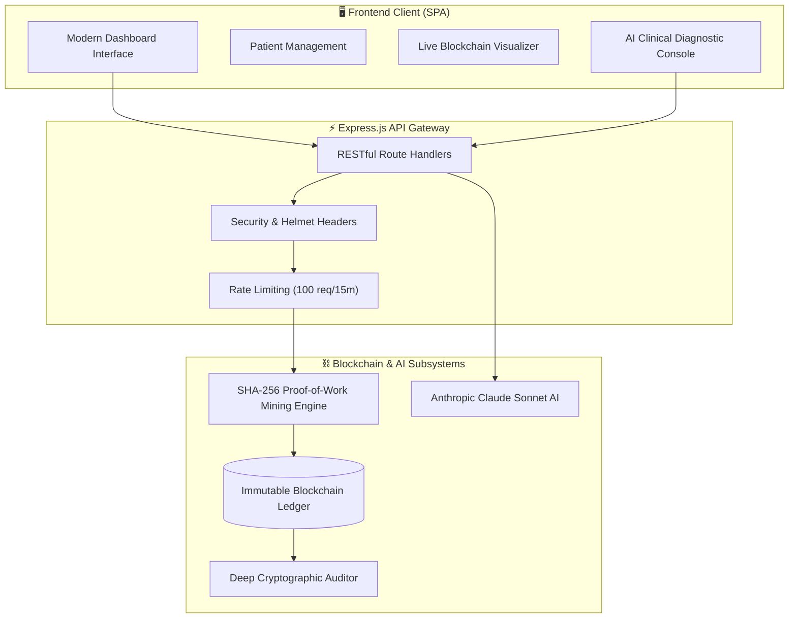
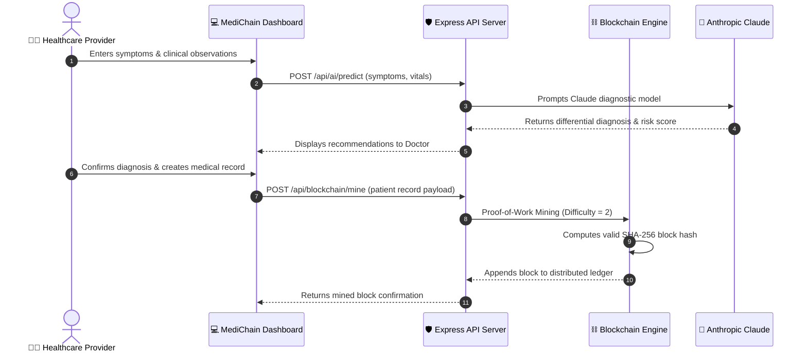

<div align="center">

# 🏥 MediChain AI
### Decentralized Medical Record Management & AI-Powered Diagnostic Engine

[](https://opensource.org/licenses/MIT)
[](https://nodejs.org/)
[](https://expressjs.com/)
[](https://www.anthropic.com/)
[](https://github.com/Dharnishkumaran0831/medichain-ai)

<p align="center">
  <b>A tamper-proof Electronic Health Record (EHR) ecosystem combining custom SHA-256 cryptographic proof-of-work blockchain with Anthropic Claude AI for clinical disease risk analysis and diagnostic assistance.</b>
</p>

[📖 API Documentation](#-api-endpoints-reference) • [🏛️ System Architecture](#-system-architecture) • [🚀 Quick Start](#-quick-start) • [🔒 Security Model](#-security--compliance-framework)

</div>

---

## 🎯 Executive Overview & Problem Statement

Traditional centralized healthcare databases suffer from single points of failure, vulnerable patient privacy, unauthorized record tampering, and siloed diagnostic workflows.

**MediChain AI** bridges decentralized cryptographic storage with next-generation artificial intelligence:
- 🔗 **Immutable Medical Records:** Every clinical consultation, lab result, and prescription is mined into a cryptographic block linked via SHA-256 hashes.
- 🔍 **Real-Time Chain Audit & Tamper Detection:** Deep chain verification automatically identifies altered blocks and broken cryptographic linkages.
- 🧠 **AI Disease Prediction:** Leverages Anthropic Claude to analyze patient symptoms, medical history, and clinical observations for instant differential diagnoses.
- ⚡ **Zero-Friction Single Page Architecture:** High-performance, lightweight frontend interface with real-time analytics dashboards.

---

## 🏛️ System Architecture



### 🔄 Patient Record & Mining Workflow



---

## ✨ Core Features & Capabilities

| Feature | Description | Key Advantage |
| :--- | :--- | :--- |
| **⛓️ SHA-256 Proof-of-Work** | Custom cryptographic mining engine with adjustable difficulty | Ensures data immutability and anti-tamper security |
| **🤖 Claude AI Clinical Insights** | Automated differential diagnosis and symptom risk scoring | Reduces physician diagnostic overhead and catch edge cases |
| **👥 Patient Identity Store** | Secure demographic and medical profile management | Structured EHR records with unique patient identifiers |
| **📊 Real-Time Chain Visualizer** | Interactive visual timeline of all mined blocks and transactions | Complete auditability for patients, doctors, and auditors |
| **🛡️ Cryptographic Integrity Auditor** | Instant mathematical validation across all blocks in the ledger | Immediate detection of corrupted or injected records |
| **⏱️ System Telemetry & Health** | Node uptime, memory utilization, and chain metrics endpoint | Production monitoring and operational visibility |

---

## 🛠️ Technology Stack

| Layer | Technologies |
| :--- | :--- |
| **Backend Runtime** | Node.js (v18+ LTS), Express.js 4.18 |
| **Cryptographic Core** | SHA-256 (Node `crypto` + `crypto-js`), Custom Proof-of-Work |
| **Artificial Intelligence** | Anthropic Claude API (`claude-sonnet-4`) |
| **Frontend Framework** | Modular Vanilla JavaScript (ES6+ Modules), CSS3 Glassmorphism |
| **Security & Hardening** | Helmet, CORS origin controls, Express Rate Limiter, Strict Headers |
| **Code Quality** | Prettier code standards, EditorConfig, Modular schemas |

---

## 🔌 API Endpoints Reference

### 1. System & Telemetry
| Method | Endpoint | Description |
| :--- | :--- | :--- |
| `GET` | `/api/health` | Node operational status, uptime, memory usage, and chain health |

### 2. Blockchain Management
| Method | Endpoint | Description |
| :--- | :--- | :--- |
| `GET` | `/api/blockchain` | Retrieve the entire blockchain ledger |
| `GET` | `/api/blockchain/stats` | Blockchain summary metadata, block height, and mining parameters |
| `GET` | `/api/blockchain/validate` | Cryptographic chain audit and continuity verification |
| `POST` | `/api/blockchain/mine` | Mine a new block with patient medical record data |

### 3. Patient Management
| Method | Endpoint | Description |
| :--- | :--- | :--- |
| `GET` | `/api/patients` | Retrieve all registered patient profiles |
| `GET` | `/api/patients/:id` | Fetch specific patient demographic and health profile |
| `POST` | `/api/patients` | Register a new patient in the system |
| `PUT` | `/api/patients/:id` | Update patient records and clinical status |
| `DELETE`| `/api/patients/:id` | Archive or deactivate patient profile |

### 4. Artificial Intelligence & Analytics
| Method | Endpoint | Description |
| :--- | :--- | :--- |
| `POST` | `/api/ai/predict` | Generate AI clinical risk analysis and disease predictions |
| `GET` | `/api/records/stats` | Aggregated clinical analytics and dashboard KPI metrics |
| `GET` | `/api/records/patient/:id`| Retrieve verified medical records for a specific patient |

---

## 🚀 Quick Start

### Prerequisites
- [Node.js](https://nodejs.org/) (v18.0.0 or higher)
- [npm](https://www.npmjs.com/) (v9.0.0 or higher)
- Anthropic Claude API Key ([Anthropic Console](https://console.anthropic.com/))

### 1. Clone & Install
```bash
# Clone the repository
git clone https://github.com/Dharnishkumaran0831/medichain-ai.git
cd medichain-ai

# Install root dependencies
npm install
```

### 2. Environment Configuration
```bash
# Create local environment file from template
cp .env.example .env
```
Edit `.env` and provide your credentials:
```env
PORT=3000
NODE_ENV=development
ANTHROPIC_API_KEY=sk-ant-your-api-key-here
```

### 3. Start Application
```bash
# Production mode
npm start

# Development mode (with live reload)
npm run dev
```

### 4. Access Dashboard
Navigate to `http://localhost:3000` in your web browser.

---

## 🔒 Security & Compliance Framework

- **Cryptographic Immutability:** Medical record blocks are chained using SHA-256 hashes. Changing a single character in past records invalidates all subsequent block hashes.
- **Strict Environment Isolation:** API keys and cryptographic secrets are restricted to backend environment variables.
- **Enterprise HTTP Hardening:** Pre-configured security headers enforce `X-Content-Type-Options: nosniff`, `X-Frame-Options: DENY`, and strict referrer policies.
- **Rate-Limited API Endpoints:** Built-in rate limiting prevents brute-force abuse and API denial of service.

---

## 📁 Repository Directory Structure

```
medichain-ai/
├── client/                     # Single Page Application Frontend
│   ├── assets/                 # Icons, badges, and static graphics
│   ├── js/                     # Modular frontend clients (api, app, blockchain, ai)
│   ├── styles/                 # Glassmorphic layout & component styling
│   ├── index.html              # SPA application shell
│   ├── robots.txt              # Search engine crawler policies
│   └── sitemap.xml             # XML sitemap configuration
├── server/                     # Node.js & Express API Gateway
│   ├── index.js                # Server entry point & middleware initialization
│   ├── models/
│   │   ├── Block.js            # Cryptographic block model & proof-of-work mining
│   │   ├── Blockchain.js       # Blockchain ledger singleton
│   │   ├── Patient.js          # Patient data storage model
│   │   └── RecordSchema.js     # Standardized EHR payload contracts
│   ├── routes/
│   │   ├── ai.js               # Claude AI diagnostic endpoints
│   │   ├── blockchain.js       # Blockchain query & mining endpoints
│   │   ├── health.js           # Node health & telemetry route
│   │   ├── patients.js         # Patient CRUD operations
│   │   └── records.js          # EHR statistics & query endpoints
│   ├── middleware/
│   │   ├── errorHandler.js     # Global exception handler
│   │   ├── logger.js           # HTTP request logger
│   │   └── securityHeaders.js  # Enterprise security headers middleware
│   └── utils/
│       ├── chainValidator.js   # Cryptographic chain integrity auditor
│       └── hashHelper.js       # SHA-256 helper utilities
├── .env.example                # Environment configuration template
├── .gitattributes              # Git text normalization settings
├── .gitignore                  # Git untracked files specification
├── .prettierrc.json            # Prettier code formatting rules
├── package.json                # Project dependencies and npm scripts
└── README.md                   # Enterprise documentation
```

---

## 👨‍💻 Author & Contributions

**Dharnishkumaran R**  
*B.Tech Information Technology — V.S.B. Engineering College*

- **GitHub:** [@Dharnishkumaran0831](https://github.com/Dharnishkumaran0831)
- **LinkedIn:** [Dharnishkumaran R](https://www.linkedin.com/in/dharnishkumaran-r-019986322/)
- **LeetCode:** [Dharnishkumaranrdk](https://leetcode.com/u/Dharnishkumaranrdk/)
- **Email:** dharnishkumaranrdk@gmail.com

---

<div align="center">
  <b>⭐ If you find MediChain AI interesting or helpful, please consider starring the repository on GitHub! ⭐</b>
</div>
